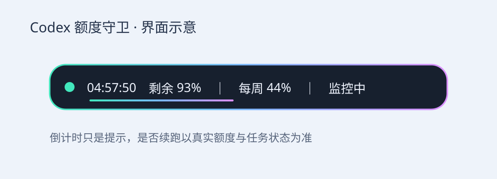

# Codex 额度守卫

Windows 桌面悬浮条：查看额度、倒计时，自动发现本地任务，并在确认额度恢复后请求继续因额度耗尽而失败的会话。

> 开发预览版 0.5.0，第三方社区项目，与 OpenAI 官方无隶属关系。不是独立 exe，也不是原生宠物窗口扩展。

## 功能

- 紧凑悬浮条、呼吸动画、额度进度与恢复倒计时。
- 自动发现本地未归档会话，无需逐个添加。
- 根据真实额度及最新错误判断是否续跑，记录提交与执行确认。
- 防止重复提交；跳过正在运行、用户停止、普通失败的任务。
- 登录启动及无控制台后台监听。

## 安装

需要 Windows、Python 3.10+（含 tkinter）、已登录的 Codex CLI，以及桌面提供的第一方 Codex App Tools 接口。仅使用 Python 标准库。

1. 下载本仓库并保留在固定目录。
2. 在该目录运行 `./configure.ps1`，生成本机配置。
3. 在 Codex 的真实执行环境运行 `./connect.ps1`，验证桌面连接。
4. 运行 `./start.ps1`；演示界面可用 `./start.ps1 -Demo`。
5. 可选：运行 `./install-autostart.ps1` 安装当前用户后台监听。移除用 `./install-autostart.ps1 -Remove`。

插件包使用 `./package.ps1` 生成本地市场。插件生命周期钩子须在 Codex 中审阅并信任，安装不会自动信任。

## 当前限制

- 桌面重启会更换连接地址。0.5.0 加入会话启动/恢复钩子刷新地址，但其环境变量、信任状态及跨重启完整流程仍需验证，不能保证无人值守恢复。
- 仅打开应用且未恢复会话，不保证触发钩子。连接失效时需在 Codex 内重新运行 `./connect.ps1`。
- 依赖桌面接口能力及最近会话列表；不保证覆盖所有历史任务。
- 仅明确额度失败自动恢复。网络错误、用户中断、审批等待不自动放行。
- 电脑需开机、登录、联网。倒计时为接口提供的重置时间，实际能否续跑以接口额度为准。

## 文档

[安装与排障](docs/TROUBLESHOOTING.md) · [架构](docs/ARCHITECTURE.md) · [公众号文章](docs/公众号文章.md) · [贡献指南](CONTRIBUTING.md) · [安全说明](SECURITY.md) · [变更记录](CHANGELOG.md)

## 测试与授权

运行 `python -m unittest discover -s tests`。开发环境此前通过 68 项测试；这不等于跨重启可靠性保证。

本项目采用 [MIT 许可证](LICENSE)，允许使用、修改和分发，按原样提供。
