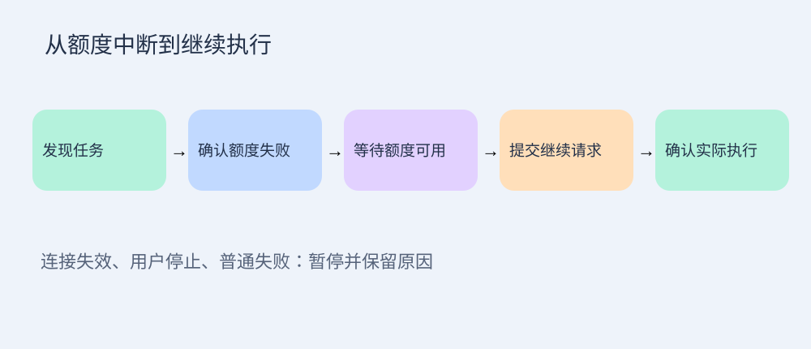

# 架构

Tkinter 负责悬浮条；后台线程读取真实桌面额度与会话。SQLite 记录恢复意图、提交和执行确认，避免响应丢失时重复发送。

独立 App Server 用于本地列表发现；桌面会话的历史和执行状态以桌面接口为准。续跑请求交给桌面自身执行，不创建竞争运行时。

生命周期钩子发布实际执行环境提供的地址；Windows 任务计划程序负责无控制台监听。不能从旧后台进程自动推导新地址。
