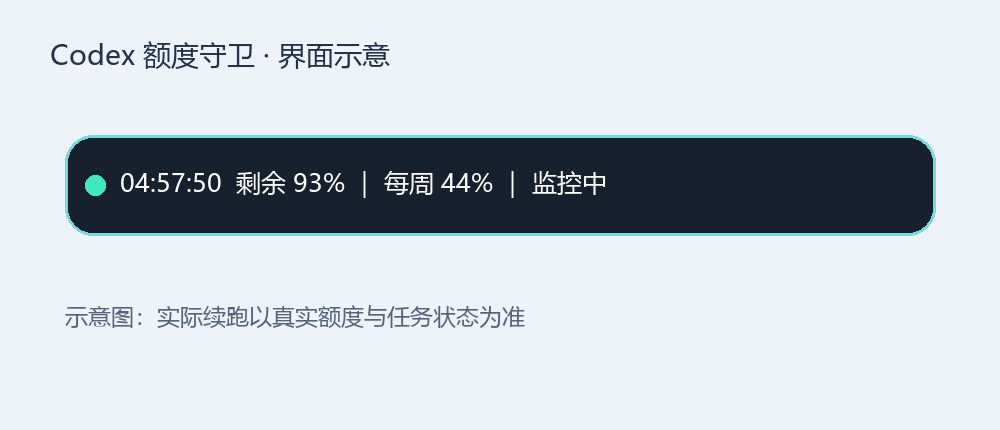
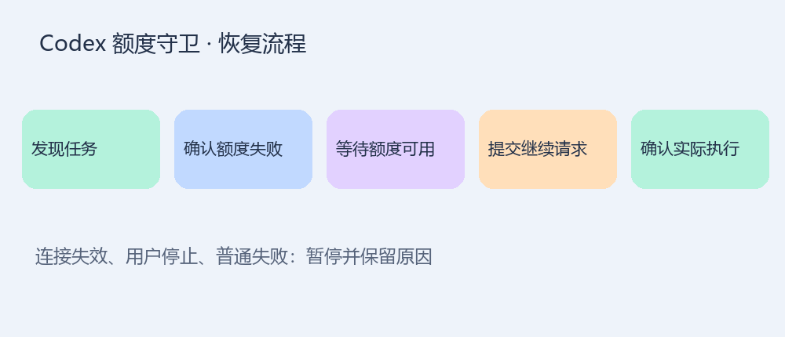

# 额度恢复了，任务却没动？我做了一个 Codex 额度守卫

一项长任务做到一半，额度耗尽。几小时后额度恢复，会话却还停在原地。你只能回到电脑前，再说一句“继续”。

为了减少这样的重复操作，我做了一个 Windows 小工具：**Codex 额度守卫**。

*图 1：界面示意。具体外观与当前版本、系统缩放有关。*

## 它做的事很简单：看额度，也看任务

悬浮条显示额度进度、恢复倒计时和任务状态。后台自动发现本地未归档任务，不需要手动一条条添加。

但它不会看到倒计时归零就盲目发送“继续”。它先确认接口报告额度可用，再检查任务最后一轮是否确实因额度耗尽失败，最后交给原桌面会话执行。

*图 2：提交请求之后，还要核对新的执行轮次。*

## 真正难的，是避免“看起来成功”

这个工具的开发并不顺利。遇到过新分页历史格式无法读取、桌面错误缺少额度代码、程序升级导致路径失效，以及桌面重启后连接地址变化。

最初，“接口连上了”很容易被当成“任务能恢复”。后来加入恢复记录，区分发现中断、记录意图、提交请求、确认执行和结束，才有办法知道它到底卡在哪一步。

工具也有边界：你主动停止的任务、普通网络错误、等待审批的操作，都不应该因为额度恢复就被自动放行。提交成功也不等于原项目已经做完。

## 适合什么场景？

如果你经常让 Codex 处理较长的本地开发任务，希望随时知道额度情况，并减少额度中断后的手动续跑，这个工具值得试用。

当前版本是 Windows 开发预览版，需要 Python、Codex CLI 和桌面接口，不是下载即用的独立安装包。

## 使用之前，请先知道这个限制

**跨桌面重启的无人值守恢复仍在验证。**0.5.0 加入会话生命周期刷新连接，但需要用户在 Codex 中审阅并信任钩子；仅打开应用、没有恢复会话时，也不保证触发刷新。连接失效时仍可能需要重新连接。

我不会把“测试通过”写成“永远不会漏恢复”。这个项目目前通过过 68 项开发测试，但真实环境中的重启、断网和版本升级，还需要持续验证。

## 如何开始

在仓库中查看 README，配置好本机运行路径，再从 Codex 的真实执行环境验证连接。建议先用演示界面熟悉显示方式，再开启自动恢复。

仓库地址：https://github.com/liuwg0910-art/codex-quota-guardian

提交问题时，请只提供脱敏后的错误摘要，不要上传账户信息、连接地址、原始数据库或私人对话。

小工具想解决的，是少一次盯着屏幕等额度、少一次回到会话说“继续”。如果你也遇到过额度恢复后任务没动，欢迎通过仓库 Issue 分享复现条件。

---

排版说明：配图已提供 PNG 格式，发布前补齐仓库链接。本文为第三方工具介绍，不代表 OpenAI 官方。
